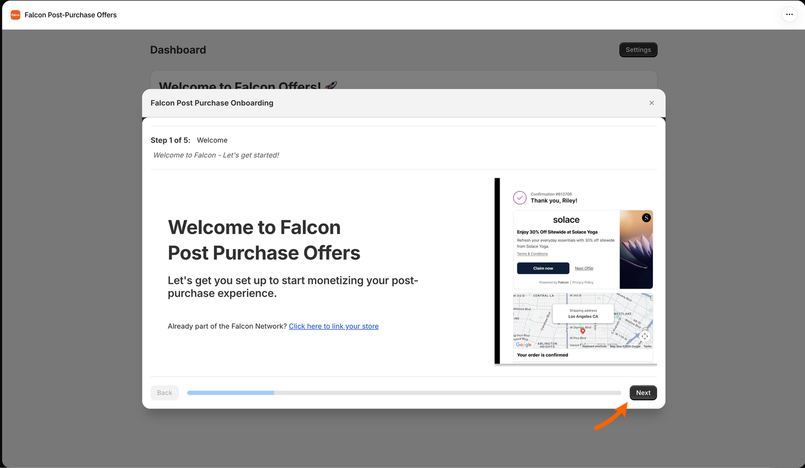
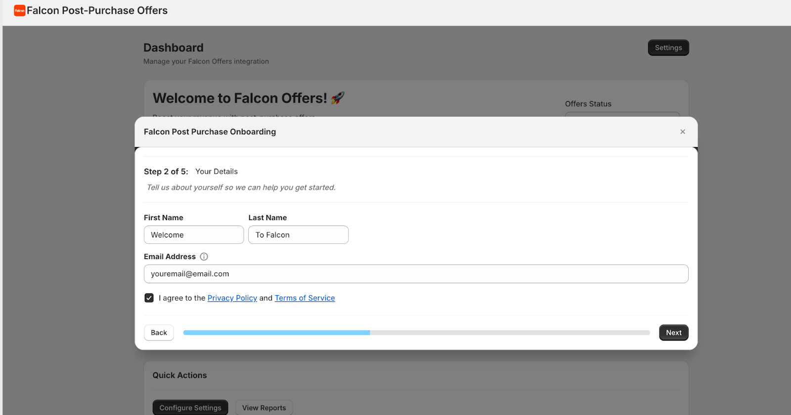
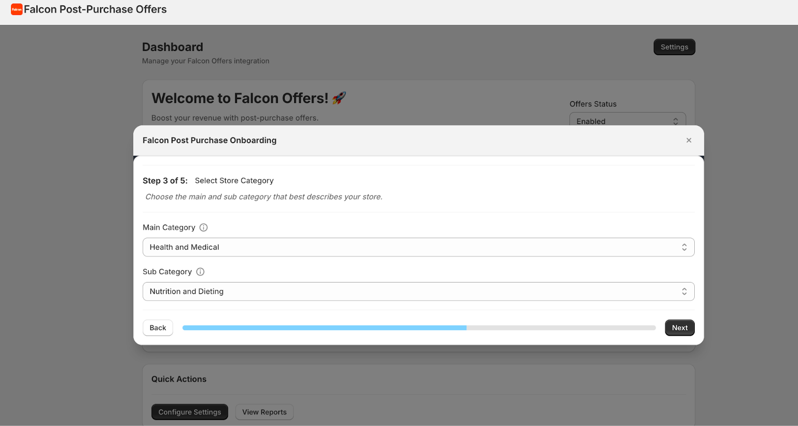
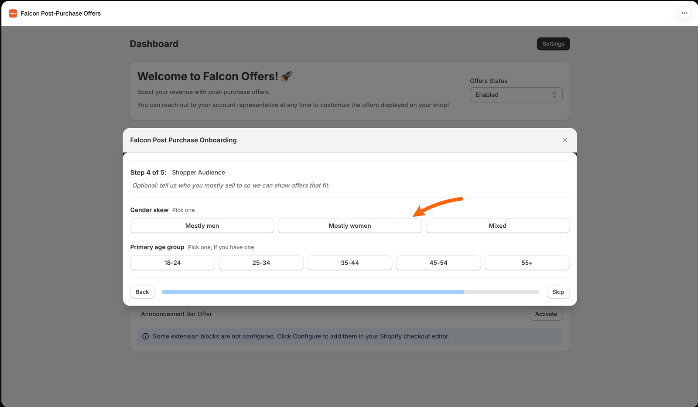
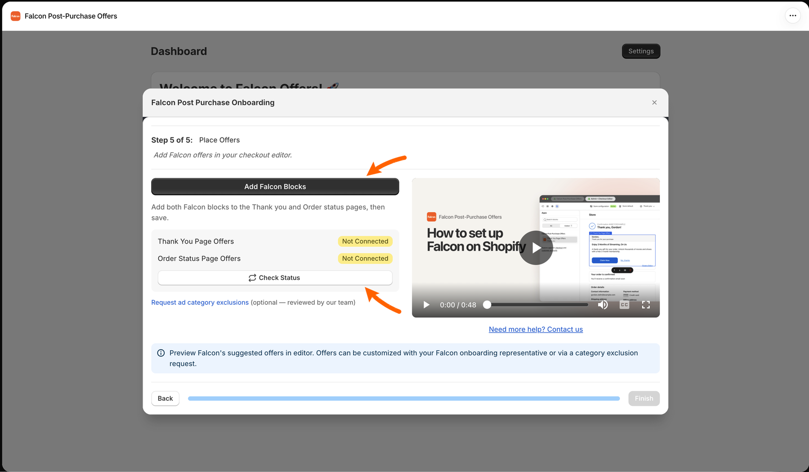

# Get started with Falcon on Shopify

Setup takes about 5 minutes. Install the app and follow the five onboarding steps.

### Install the app

Install **Falcon Post-Purchase Offers** from the [Shopify App Store](https://apps.shopify.com/falcon-cross-sell). Onboarding opens as soon as you open the app.

### Step 1: Welcome

Click **Next**. Already on Falcon? Click **link your store** instead.

### Step 2: Your details

Enter your name and email, then accept the [Privacy Policy](https://falconlabs.us/privacy) and [Terms of Service](https://www.falconlabs.us/publisher-agreement). This creates your Falcon account.

### Step 3: Store category

Pick your main category, then your subcategory.

### Step 4: Shopper audience (optional)

Pick who you mostly sell to and their main age group, or click **Skip**. You can change this later.

### Step 5: Place offers

Click **Add Falcon Blocks** to open your checkout editor. Add the Falcon blocks to your **Thank you** and **Order status** pages, then save.

Back in the app, click **Check Status**. Once a block shows **Connected**, click **Finish**. Your offers are live.

Watch the 48-second walkthrough:

<video controls preload="metadata" playsinline style="width: 100%; border-radius: 8px;" src="https://d3n0ck9hnfafu5.cloudfront.net/onboardingAssets/Falcon_Shopify_Onboarding_Step5_Adding_Blocks_V3.mp4" poster="https://d3n0ck9hnfafu5.cloudfront.net/onboardingAssets/Falcon_Shopify_Onboarding_Step5_Adding_Blocks_Poster_V2.jpg"></video>

Need help? Email [contact@falconlabs.us](mailto:contact@falconlabs.us).
